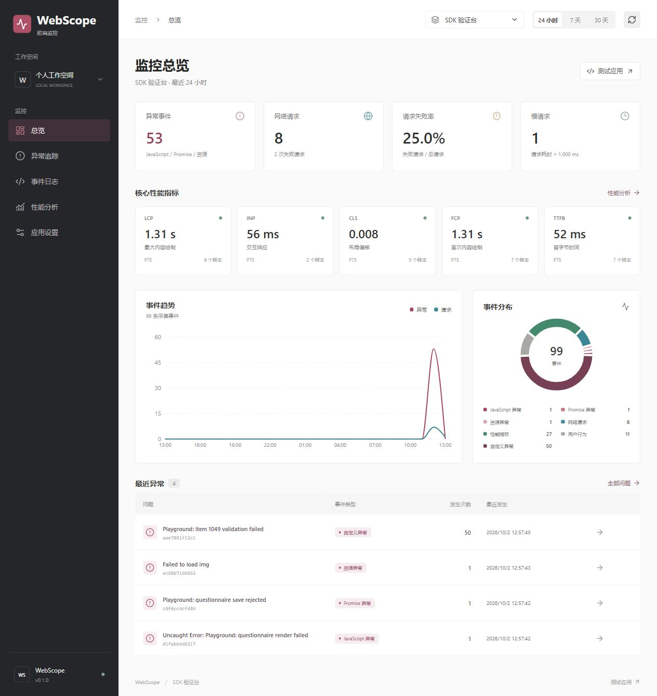

# WebScope 前端监控与性能分析平台

面向浏览器应用的轻量监控 SDK 与可视化看板，已在 React 问卷管理后台验证接入。通过 **采集、批量上报、校验入库、聚合分析** 串联异常定位与性能观测，不依赖业务项目的 React 组件生命周期。

[](https://github.com/5sc5/webscope-frontend-monitor/actions/workflows/ci.yml)

技术栈：TypeScript / React 19 / Vite / Recharts / Koa / Prisma / SQLite / Vitest / web-vitals。



截图来自本机真实触发的验证事件；仓库不包含数据库，首次启动看板为空。

## 技术重点

- **业务无侵入采集**：包装 Fetch / XHR / History，保留原调用语义；采集运行时异常、Promise 拒绝、资源错误和用户操作 Breadcrumb。
- **可靠上报链路**：条数与时间双阈值、有限队列、退避重试、服务端 ACK、稳定事件 ID 去重，避免重复上报造成重复入库。
- **异常聚合与性能分析**：错误指纹归并重复问题，联动堆栈和操作链路；使用官方 Web Vitals 算法，展示 P75、样本量与评级。
- **隐私与生命周期处理**：双端敏感字段过滤，不读取表单内容及请求正文；支持暂停、恢复、销毁和 HMR 清理。
- **可核验数据**：20 项自动化测试；SDK gzip **7,065 字节**；合成实验中 1,000 条事件按 10 条批量发送，传输请求从 1,000 次降至 100 次。测量环境及边界见 [验证记录](docs/validation.md)。

## 启动

需要 Node.js 22.12 或更新版本。首次运行：

```sh
git clone https://github.com/5sc5/webscope-frontend-monitor.git
cd webscope-frontend-monitor
npm ci
npm run db:setup
npm run dev
```

默认地址：

| 应用 | 地址 |
| --- | --- |
| 监控看板 | http://127.0.0.1:5174 |
| SDK 验证台 | http://127.0.0.1:5175 |
| Koa API | http://127.0.0.1:3301 |

启动脚本遇到端口占用会自动选择可用端口，并在终端输出实际地址。Ctrl+C 会停止本次启动的服务。

后台运行时，可在项目目录执行 `npm run dev:stop` 停止本项目记录的开发进程。

数据库为 `apps/server/prisma/dev.db`。启动初始化只创建应用，不生成虚假的监控事件；看板首次打开为空是正常的。打开 SDK 验证台触发异常或请求，再返回看板刷新，即可查看真实数据。再次启动不会清空已存储事件。

Windows 下数据库初始化会生成 Prisma 引擎文件；再次执行 `db:setup` 前先停止开发服务，避免正在运行的 API 锁定文件。

环境变量与默认值见 [.env.example](.env.example) 和 [服务端配置示例](apps/server/.env.example)。脚本不会自动加载根 `.env`；例如 PowerShell 可使用 `$env:API_PORT = '3302'`，macOS / Linux 可使用 `API_PORT=3302 npm run dev`。SDK 接入的业务应用需使用终端打印的实际 API 地址。

## 数据链路

```text
浏览器业务应用
  -> TypeScript SDK: 采集 / 脱敏 / Breadcrumb / 批量队列
  -> POST /api/events: 校验 / ACK / ID 去重
  -> Prisma + SQLite: 事件持久化
  -> 查询 API: 错误指纹聚合 / Web Vitals P75
  -> React 看板: 应用筛选 / 异常详情 / 事件检索 / 性能趋势
```

验证台是接入 SDK 的独立应用：按钮触发真实浏览器错误与请求，用来复现并检查链路，而不是往看板填充假的统计数。

## 项目结构

```text
webscope-frontend-monitor/
  packages/monitor-sdk/  TypeScript SDK、隐私处理、队列与自动化测试
  apps/playground/      React 验证台，产生真实异常与网络请求
  apps/dashboard/       React 监控看板
  apps/server/          Koa API、Prisma Schema、SQLite 与集成测试
  scripts/              多服务启动与可复现基准测试
```

## 核心能力

- JS 运行时异常、未处理 Promise、资源加载失败与手动异常。
- Fetch / XHR 状态、耗时和结果；原始响应与异常继续交给业务处理。
- Web Vitals：LCP、CLS、INP、FCP、TTFB，使用官方 `web-vitals` 计算。
- 最近 20 条点击、路由和请求 Breadcrumb；不读取表单输入值。
- 10 条或 5 秒双阈值批量上报、有限队列、失败重试。
- 隐藏/离开页面时尝试 Beacon 上报，回退 keepalive Fetch。
- SDK 和服务端都过滤敏感字段及 URL 参数，不采集完整请求体或认证头。
- 事件 ID 幂等入库，错误消息与堆栈特征生成指纹，聚合重复异常。
- 看板支持应用/时间筛选、事件类型筛选、搜索、分页、错误堆栈和 Breadcrumb 查看。
- 性能看板显示 P75、样本数和评级。缺失数据保持空值，不能把“未采集”理解为“性能良好”。
- `destroy()` 清理 SDK 自有监听与定时器，恢复 SDK 包装过且仍由该实例持有的浏览器方法。`web-vitals` 无公开销毁接口，其回调会在 SDK 暂停后停止采集。

## 接入 React 项目

先在“应用设置”创建 appId；开发阶段也已预置 `survey-platform`。

```ts
import { createMonitor } from '@webscope/monitor-sdk'

const monitor = createMonitor({
  appId: 'survey-platform',
  reportUrl: 'http://127.0.0.1:3301/api/events',
  batchSize: 10,
  flushInterval: 5000,
})

monitor.start()
```

SDK 尚未发布到 npm，推荐先构建并打包，再在业务项目安装 `.tgz`；避免 CRA 对跨目录源码的限制。Vite 项目也可参考验证台的 alias 配置。监控实例应在应用入口创建一次，避免组件重复挂载产生多个实例。

详见 [业务应用接入指南](docs/integration.md) 和 [SDK API](packages/monitor-sdk/README.md)。本仓库独立于问卷项目，不包含问卷源码或业务数据。问卷管理后台已验证接入，Next.js 填写端尚未接入。

## 验证

```sh
npm test
npm run build
npm run benchmark
```

自动化测试验证采集、原业务行为、队列重试、脱敏、清理，以及 API 校验、幂等入库、聚合、P75 和数据持久化。服务端测试使用独立临时数据库，不污染开发数据。

`benchmark` 比较同一 SDK 在逐条上报与 10 条批量配置下处理 1,000 条事件的传输请求数，并记录 SDK gzip 体积与采集耗时，输出到 `docs/benchmark.json`。它是 Node + JSDOM 的合成实验，传输层为内存响应，不能用来声称浏览器 LCP 优化或生产网络延迟降低。

首次实测 SDK gzip 为 **7,065 字节**；1,000 条事件的逐条配置产生 1,000 次传输请求，10 条批量配置产生 100 次，减少 **90%**，两组均无队列丢弃。耗时受机器与运行环境影响，以基准 JSON 的条件为准。

验证台可复现的场景：JS、Promise、图片加载失败、Fetch 200/500、1.2 秒慢请求、中断、XHR、50 条同类错误、字段脱敏、路由切换、禁用 SDK 和手动上报。

本次浏览器检查、测试结果和截图见 [验证记录](docs/validation.md)。数据来源与测量限制均已记录，不能将验证页数据包装成生产优化收益。

## 当前边界

- 当前为本地学习项目：API 默认监听回环地址，跨域只允许本机地址；尚无生产环境账户鉴权、访问隔离、数据保留策略或告警。不要直接暴露到公网。
- 数据脱敏是字段级过滤，不能保证自由文本消息或堆栈中不存在业务敏感信息。生产接入仍需扩展过滤规则。
- Beacon 返回成功只表示浏览器接受发送队列，并不表示服务端已经确认保存。
- Web Vitals 部分指标在页面隐藏或用户交互后才最终产生；新页面可能暂时没有 LCP/CLS/INP 样本。
- 没有实现 Source Map、录屏、离线队列。错误指纹为基础策略，复杂业务可能存在误聚合，需要增加自定义规则。
- SQLite 适合本地验证；目前查询聚合在服务端内存计算，不宣称支持生产级高并发或海量事件。

更多说明见 [安全边界](SECURITY.md)。本项目公开用于学习与作品展示，不提供已经部署的公网监控服务。

## 协作与许可证

修改和验证约定见 [CONTRIBUTING.md](CONTRIBUTING.md)。GitHub Actions 在 Linux / Windows、Node.js 22 下执行干净安装、数据库初始化、测试、构建与基准实验；每次运行状态以 CI 链接为准。

当前未附带开源许可证，公开源码不等同于授权复用。第三方依赖遵循各自许可证。

## 学习路线

先阅读 `packages/monitor-sdk/src` 的事件类型、采集器、上报队列，再看 `apps/server/src` 的校验与聚合。最后将测试事件与看板数据一一对照，理解完整链路。进阶可以选择 Source Map 定位或 IndexedDB 离线队列中的一项补充。
