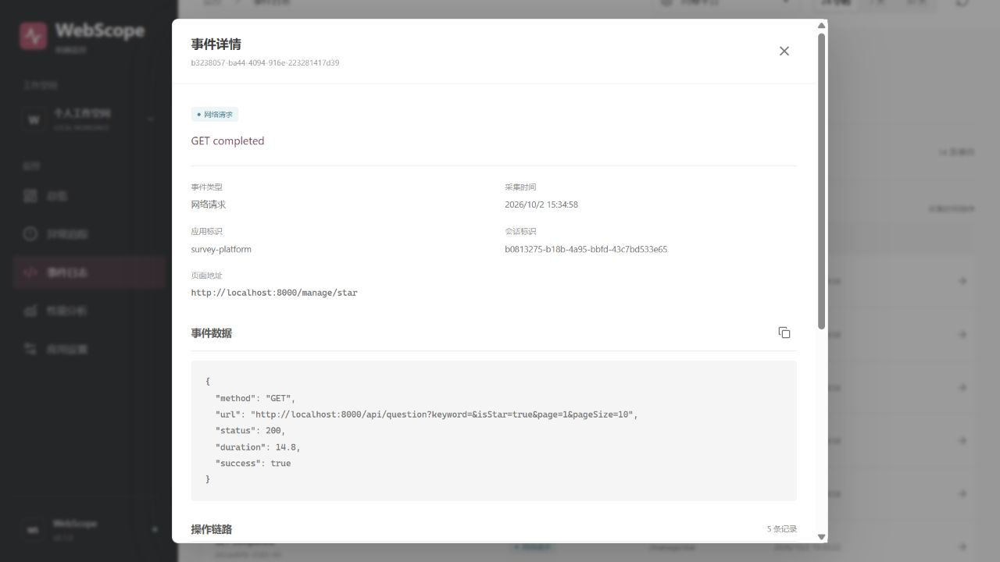

# 业务应用接入指南

SDK 是浏览器端 TypeScript 包，不依赖 React；Vue、React 或普通浏览器项目都可以接入。以下流程使用本地 API，仅适用于开发验证。

## 1. 启动平台并创建应用

按根 [README](../README.md) 启动，在「应用设置」创建 appId。初始化时预置 `playground` 与 `survey-platform`，不生成监控事件。记录终端输出的 API 地址，默认是 `http://127.0.0.1:3301`。

## 2. 构建和安装 SDK

在本仓库根目录执行：

```sh
npm run build --workspace @webscope/monitor-sdk
npm pack --workspace @webscope/monitor-sdk --pack-destination .
```

生成 `webscope-monitor-sdk-0.1.0.tgz`。在业务项目目录安装它；如果两个项目是相邻目录：

```sh
npm install ../webscope-frontend-monitor/webscope-monitor-sdk-0.1.0.tgz
```

按实际目录修改安装路径。SDK 未发布到 npm，不能直接从公共 registry 安装 `@webscope/monitor-sdk`。更新 SDK 后需重新构建、打包、安装并重启业务开发服务。Vite 验证台使用源码 alias；CRA 项目推荐使用打包文件，不使用跨目录源码链接。

## 3. 在应用入口初始化一次

Vite + React 示例 `src/monitor.ts`：

```ts
import { createMonitor, type Monitor } from '@webscope/monitor-sdk'

export let monitor: Monitor | undefined

if (import.meta.env.DEV) {
  try {
    monitor = createMonitor({
      appId: 'survey-platform',
      reportUrl: 'http://127.0.0.1:3301/api/events',
      batchSize: 10,
      flushInterval: 5000,
    }).start()
  } catch (error) {
    console.warn('Monitor initialization failed', error)
  }
}

if (import.meta.hot) {
  import.meta.hot.dispose(() => monitor?.destroy())
}
```

在 `src/main.tsx` 的应用入口导入 `./monitor`，尽量早于业务模块。不要放在每个页面或组件的 `useEffect` 里创建实例，避免 StrictMode、路由和重新挂载导致重复采集。

CRA 不支持 `import.meta.env` / `import.meta.hot`，需要改为 `process.env.NODE_ENV` 与其 HMR API。无论框架如何，保持「入口单实例、开发时启用、模块替换时销毁」的约定。SDK 的完整接口和默认配置见 [SDK README](../packages/monitor-sdk/README.md)。

## 4. 正常使用业务应用并核对数据

打开业务应用，切换页面并执行一次业务请求。等待约 5 秒，在看板选择对应应用并刷新「事件日志」，核对请求状态、耗时、路由和 Breadcrumb。业务没有异常时，「异常列表」为空是正常现象。

- Axios 的 XHR / Fetch 请求可自动采集，不改变业务凭据、响应或错误处理。
- 被业务 `catch`、ErrorBoundary 或 Router 捕获的异常，需要显式调用 `monitor?.captureError(error)`。
- HTTP 200 内的业务错误码不是 HTTP 失败，不会自动标为网络异常。
- 需要即时观察可执行 `await monitor?.flush()`；它不强制跳过已有失败事件的退避时间。
- 部分 Web Vitals 在页面隐藏或用户交互后才最终产生，缺少指标不代表指标为 0。
- API 端口改变后，要同步修改 `reportUrl` 并重启业务服务。

不要在手动事件中传入问卷内容、用户资料、完整 Axios 配置或凭据。双端过滤不是全面的隐私保证，业务自定义字段仍需审核。

## 已验证的业务接入

2026-10-02 在 React 问卷管理后台正常访问主页、列表、搜索和星标页。一次本机检查收到 26 条事件，其中 14 条请求，0 条异常、0 条失败请求，证明采集与看板查询链路可用。未改写问卷或答卷数据，Next.js 填写端尚未接入。

该次少量样本的 LCP / FCP / TTFB P75 为 668 / 536 / 26 ms，仅用于验证采集，不代表生产表现或优化收益。问卷项目的源码、数据库和测试不在此仓库。



## 生产部署前

`127.0.0.1` 指向访问者自己的电脑，不能作为公网业务的上报地址。目前 API 没有鉴权、租户隔离和限流，只允许本机跨域。上线前需要独立部署 HTTPS API，补齐这些能力及数据保留策略，配置可信来源，审核隐私字段，再显式启用生产采集。不要直接将现有开发 API 暴露到公网。
